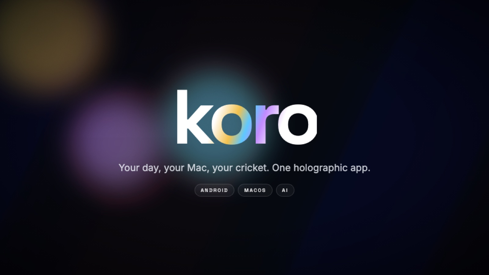
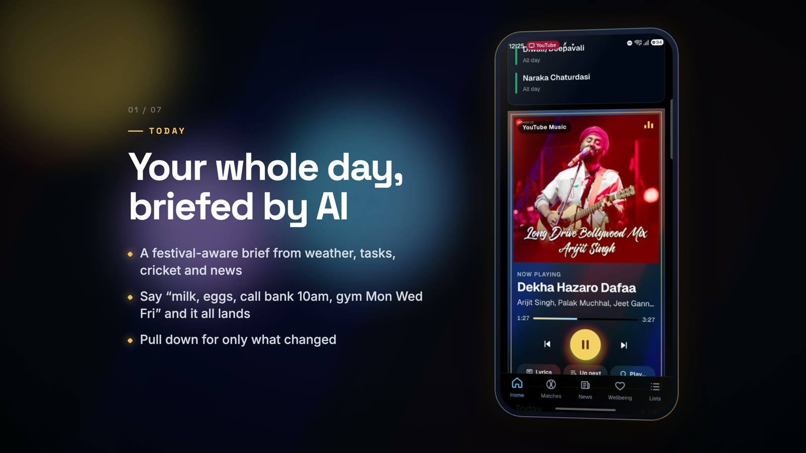
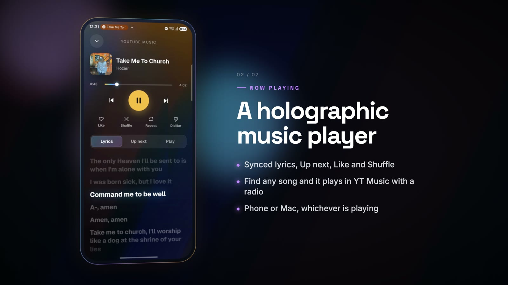
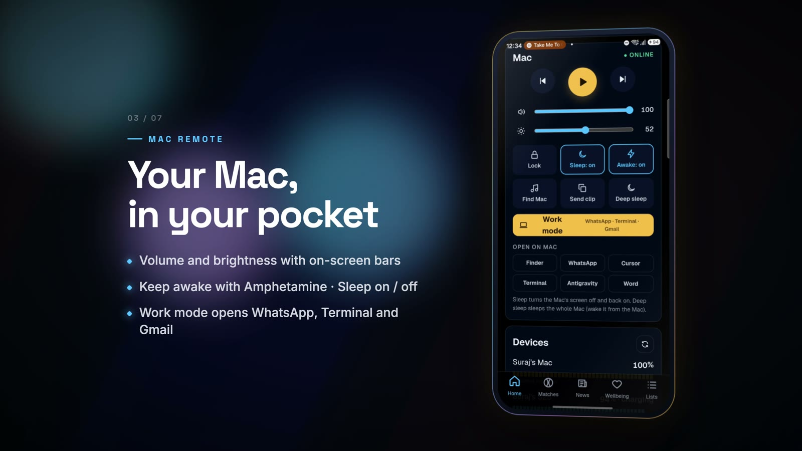
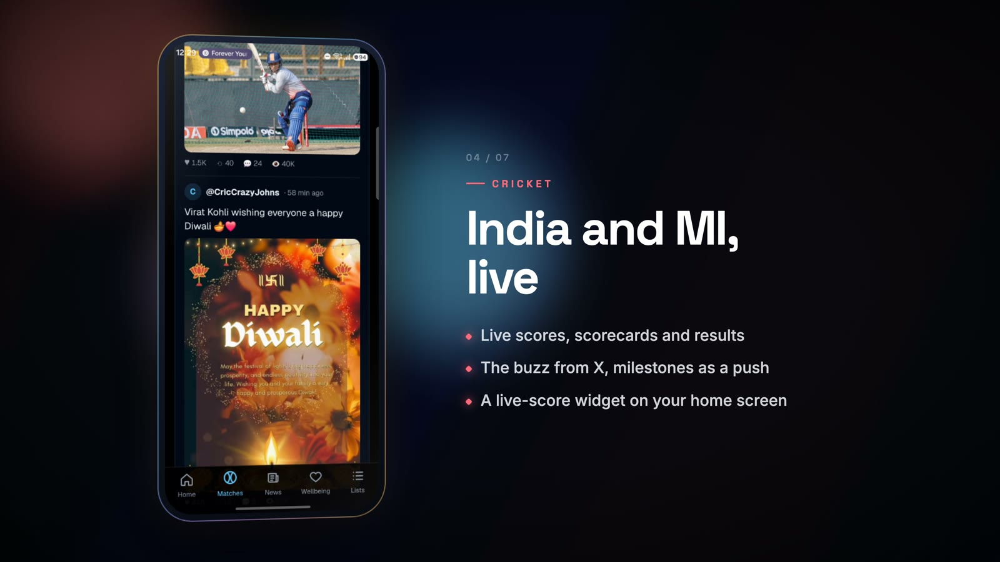
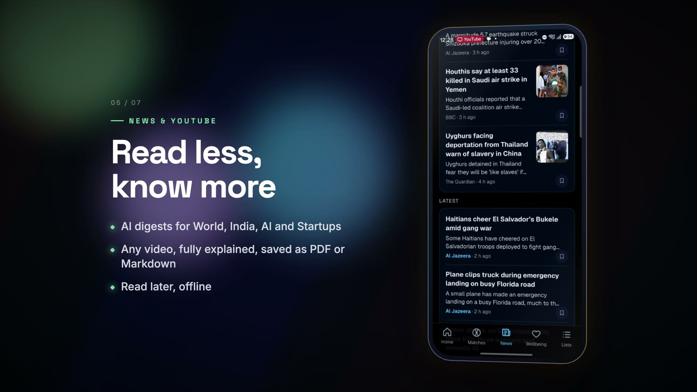
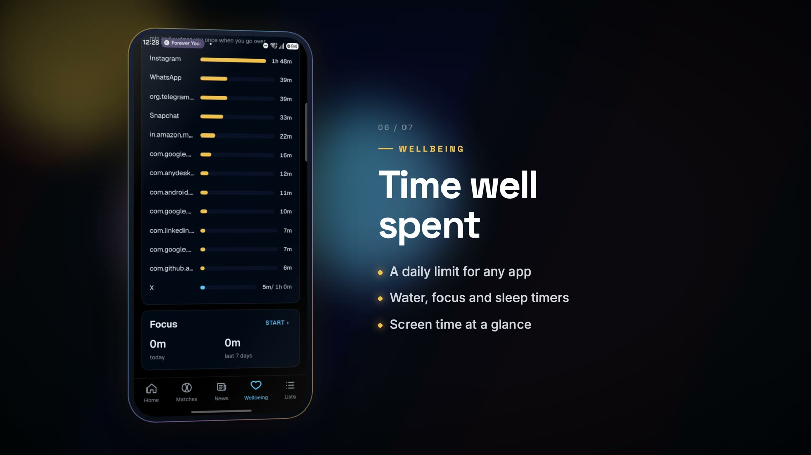
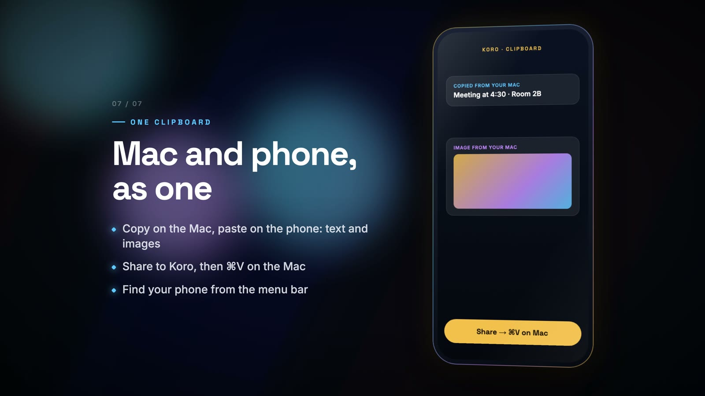

<div align="center">



# koro

**Your day, your Mac, your cricket. One holographic app.**

An AI daily brief, live cricket, news and YouTube digests, a holographic music player, a remote for your Mac and one shared clipboard, in a single Android app that you host yourself.

[](LICENSE)


[Features](#features) · [How it works](#how-it-works) · [Quick start](#quick-start) · [Self-hosting](#self-hosting-in-production) · [Contributing](#contributing)

</div>

---

## Why koro

Your phone already has a weather app, a news app, a cricket app, a music app, a screen-time app, a notes app and a "find my" app, and your Mac doesn't talk to any of them. koro puts all of that in one fast, good-looking app that you own. A small server you run does the slow work (AI summaries, live scores, feeds), and a tiny menu-bar agent turns your Mac into something your phone can control.

- **One app, not twelve.** Brief, scores, news, music, lists, wellbeing and Mac controls each have their own tab.
- **Yours.** Self-hosted and paired with a code. No accounts, no tracking, no ads.
- **Fast.** Pull to refresh fetches only what changed (ETags and 304s), and everything works offline from the cache.
- **Beautiful.** A holographic foil look in sky blue, silver and gold, with pixel-type accents and smooth motion.

## Features

<table>
<tr>
<td width="50%"></td>
<td width="50%"></td>
</tr>
<tr>
<td>

### 🌅 Today
AI morning and night briefs built from your weather, calendar, tasks, cricket and news. They know the festivals too, so on Diwali or Holi the brief greets you and mentions a real custom. Quick add by voice or text: type *"milk, eggs, call bank 10am, gym Mon Wed Fri"* and each item lands in the right list.

</td>
<td>

### 🎧 Now playing
A holographic player for whatever's playing on your phone **or your Mac**. It has synced lyrics, Up next, Like, Shuffle and Repeat. Search any song and it starts in YouTube Music with a radio mix.

</td>
</tr>
<tr>
<td></td>
<td></td>
</tr>
<tr>
<td>

### 💻 Mac remote
Play and pause, plus volume and brightness sliders that stay in sync both ways, with the on-screen HUD on the Mac. It also has Lock, display Sleep on/off, Keep awake (through [Amphetamine](https://apps.apple.com/app/amphetamine/id937984704), or `caffeinate` without it), Deep sleep and Find my Mac. **Work mode** opens your work apps, and one-tap launchers open the rest.

</td>
<td>

### 🏏 Cricket
Live scores, scorecards and results for India and Mumbai Indians, with the buzz from X. Alerts come at the moments that matter: every over in the IPL, milestones in T20Is and ODIs, and session breaks in Tests. There's also a live-score widget for your home screen.

</td>
</tr>
<tr>
<td></td>
<td></td>
</tr>
<tr>
<td>

### 📰 News & YouTube
AI digests for World, India, AI & Tech and AI Startups. Any YouTube video can be fully explained from its transcript and saved as PDF or Markdown. There's also a "What your people are saying" summary of the X accounts you follow, and you can save anything to read later offline.

</td>
<td>

### 🌿 Wellbeing
Set a daily limit for any app and see your screen time at a glance. It also tracks water, habits and reminders, and has Focus mode (Do Not Disturb) and a sleep timer.

</td>
</tr>
<tr>
<td></td>
<td>

### 📋 One clipboard
Copy text or an **image** on the Mac and it's on your phone. Share a photo or text to koro on your phone, then press ⌘V on the Mac.

### 🧩 And more
- **Home-screen widgets:** Today, Water (+1 glass), Mac remote, live cricket, Now playing and your lists.
- **Desk mode:** a clock and calendar for a docked phone.
- **Devices:** battery for your phone and Mac in one place.
- **Inbox:** every alert also lands in the app, even without push.

</td>
</tr>
</table>

> ▶ **See it move:** a 4K walkthrough film made with [Remotion](https://www.remotion.dev/) from real screen recordings lives in [`video/`](video/).

## How it works

```
┌──────────────────────┐        HTTPS / LAN        ┌───────────────────────────┐
│  Android app         │ ◀───────────────────────▶ │  koro server (Bun + Hono) │
│  Tauri 2 + Svelte 5  │   paired with a code      │  Postgres · AI · FCM push │
│  + Kotlin plugin     │                           │  cricket engine · feeds   │
│  (widgets, limits,   │                           └─────────────▲─────────────┘
│   focus, media)      │                                         │
└──────────────────────┘                                         │ commands, now playing,
                                                                 │ clipboard, battery
                                                   ┌─────────────┴─────────────┐
                                                   │  Mac companion            │
                                                   │  Swift menu-bar agent     │
                                                   │  + X / YouTube collector  │
                                                   └───────────────────────────┘
```

| Folder | What's inside |
|---|---|
| [`app/`](app/) | Tauri 2 + Svelte 5 phone app. The native side (widgets, usage limits, Focus, media session) is a Kotlin plugin in `app/src-tauri/plugins/tauri-plugin-koro`. |
| [`server/`](server/) | Bun + Hono API: Postgres (embedded PGlite locally, Neon in production), the cricket engine, AI briefs and digests, news, lyrics, YouTube and FCM push. |
| [`mac-companion/`](mac-companion/) | `koro-agent.swift` (menu-bar agent: remote, now playing, clipboard), `koro-x.py` (X and YouTube collector) and `koro-mac.sh` (installer). |
| [`shared/`](shared/) | The quick-add parser, shared by the app and the server. |
| [`video/`](video/) | A Remotion project for the 4K product film. |
| [`docs/`](docs/) | Architecture, plan and UI/UX notes. |

## Quick start

You need [Bun](https://bun.sh), an Android phone and, for the Mac features, a Mac.

### 1. Run the server

```sh
cd server
cp .env.example .env         # set SETUP_CODE (bun run pair-code makes one) and AI_API_KEY
bun install
bun src/index.ts             # http://0.0.0.0:8787
bun test
```

Data lives in an embedded Postgres under `server/data/`, so there's nothing else to install.

### 2. Build and install the Android app

You need about **8 GB of free disk** for the NDK, Gradle and the Rust Android build.

```sh
# one-time toolchain
export ANDROID_HOME=/opt/homebrew/share/android-commandlinetools
sdkmanager "ndk;27.2.12479018" "platforms;android-36" "build-tools;36.0.0" "platform-tools"
export NDK_HOME=$ANDROID_HOME/ndk/27.2.12479018
rustup target add aarch64-linux-android

cd app
bun install
bunx tauri android init      # generates src-tauri/gen/android (once)
bun run android:build
adb install -r src-tauri/gen/android/app/build/outputs/apk/universal/release/app-universal-release.apk
```

Open koro, go to **Settings**, and pair with `http://<your-computer-ip>:8787` and your `SETUP_CODE`. The phone and the server must be on the same Wi-Fi. Settings also has a button for each permission: notifications, exact alarms, Do Not Disturb access (Focus), Usage access (screen time) and unrestricted battery.

### 3. Add your Mac (optional)

```sh
mac-companion/koro-mac.sh pair http://localhost:8787 <SETUP_CODE>
mac-companion/koro-mac.sh install    # builds the agent with swiftc and installs the launchd jobs
```

The agent lives in the menu bar. It reports battery, volume, brightness and what's playing (Music, Spotify, and Safari or Chrome tabs including YouTube Music), runs commands from your phone, and syncs the clipboard both ways. macOS asks for **Accessibility** (media keys) and **Automation** (Amphetamine, browsers, Music) on first launch. Re-run `install` after you pull changes.

## Configuration

Only `SETUP_CODE` is required, and `AI_API_KEY` turns on the AI features. Everything else in [`server/.env.example`](server/.env.example) is optional:

| Key | What it adds |
|---|---|
| `AI_API_KEY`, `AI_BASE_URL`, `AI_MODEL` | Briefs, digests and video explanations. Works with any OpenAI-compatible endpoint. |
| `APP_TZ` | Your time zone for briefs and reminders (default `Asia/Kolkata`). |
| `CRICKETDATA_API_KEY` | Exact overs for milestone alerts, session breaks in Tests and player scores. The free plan gives 100 calls a day. |
| `SPORTMONKS_API_TOKEN` | Faster India T20I updates. |
| `FCM_SERVICE_ACCOUNT_JSON` + `FIREBASE_*` | Real push notifications while the app is closed. Create a Firebase project with an Android app for package `com.koro.app`. |

With no keys at all, cricket still works from the free Cricinfo RSS feed, and every alert lands in the in-app inbox.

<details>
<summary><b>Cricket alert rules</b></summary>

| Match | When you're notified |
|---|---|
| IPL (MI) | Every over |
| India T20I | After overs 5, 10, 15 and 20 of each innings, plus the result |
| India ODI | After overs 10, 20, 30, 40 and 50 of each innings, plus the result |
| India Test | At Lunch, Tea and Stumps each day, plus the result |

</details>

## Self-hosting in production

The included setup runs on a small ARM instance behind Caddy, which handles HTTPS automatically, with a Neon Postgres database.

1. **Database:** create a [Neon](https://neon.tech) project and copy its **pooled** connection string.
2. **Server:** launch a small Linux VM (for example an AWS `t4g.small` running Amazon Linux 2023) and open ports 80 and 443. Then:
   ```sh
   # COPYFILE_DISABLE stops macOS adding ._* files (they would be run as migrations)
   COPYFILE_DISABLE=1 tar czf - --exclude=server/node_modules --exclude=server/data --exclude='server/.env*' server shared \
     | ssh ec2-user@<ip> 'mkdir -p ~/koro && cd ~/koro && tar xzf -'
   scp server/.env ec2-user@<ip>:~/koro/server/.env
   ssh ec2-user@<ip> 'bash ~/koro/server/deploy/ec2-setup.sh'
   ```
3. On the server, set `DATABASE_URL=<neon pooled url>` in `~/koro/server/.env`.
4. Log out and back in, then from `~/koro`:
   ```sh
   echo DOMAIN=<your-domain> > server/deploy/.env
   docker compose -f server/deploy/docker-compose.yml up -d --build
   ```
   No domain? Use `api.<elastic-ip-with-dashes>.sslip.io`.
5. In the app, open **Settings → Unpair** and pair again with `https://<your-domain>`.

## The film

```sh
cd video
npm install
npm run studio     # preview and tweak scenes (src/scenes.ts holds the script)
npm run render     # → out/koro-4k.mp4, 3840×2160, 30 fps
```

Scenes play real screen recordings inside a 3D phone frame on a holographic background.

## Status

koro started as a personal app for a Samsung Galaxy S25 and a MacBook Air, so some of it is opinionated. Cricket follows India and Mumbai Indians, and the default time zone is IST. Contributions that make it more general are very welcome: other teams and sports, other time zones, iOS, Linux and Windows companions.

## Contributing

Issues and pull requests are welcome.

1. Fork the repo and create a branch.
2. For server changes, run `bun test` in `server/`. For app changes, run `bun run check` in `app/`.
3. Keep secrets out of commits. `.env` files are ignored, so add new keys to `server/.env.example`.
4. Open a pull request describing what changed and how you tested it.

See [`docs/ARCHITECTURE.md`](docs/ARCHITECTURE.md) for how the pieces fit together.

## License

[MIT](LICENSE) © Surajsingh Bayas
